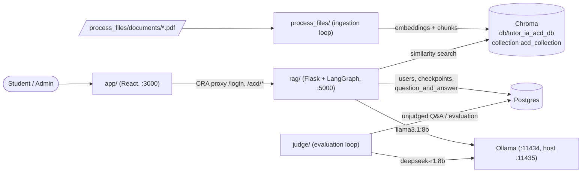
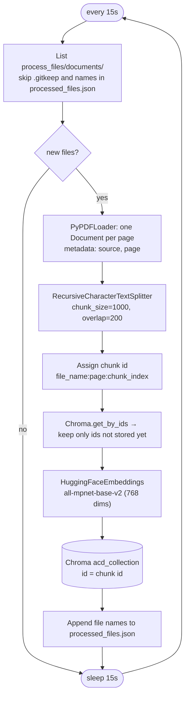
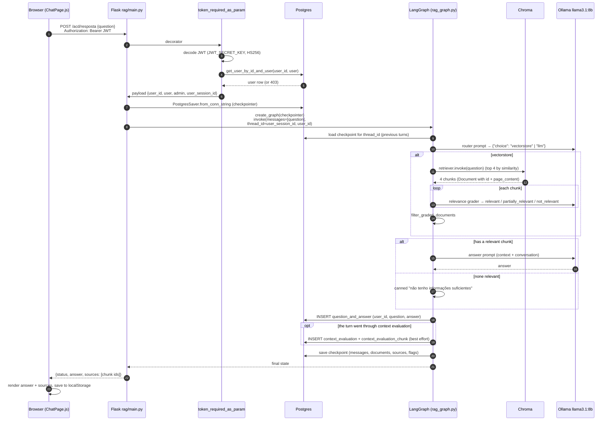
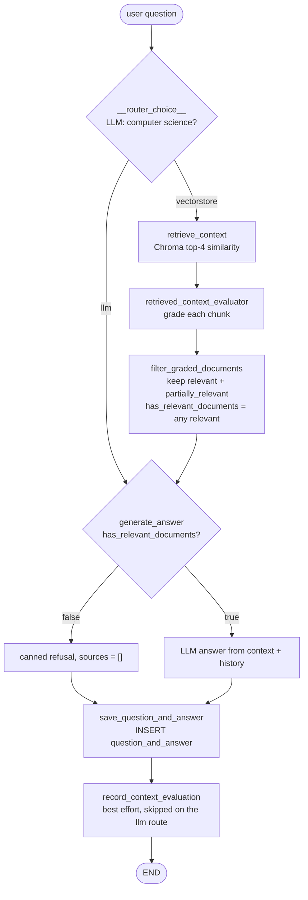
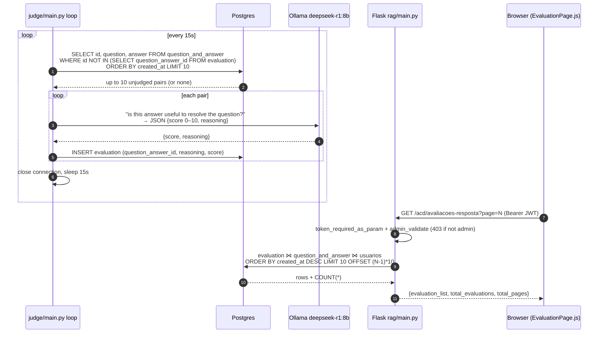
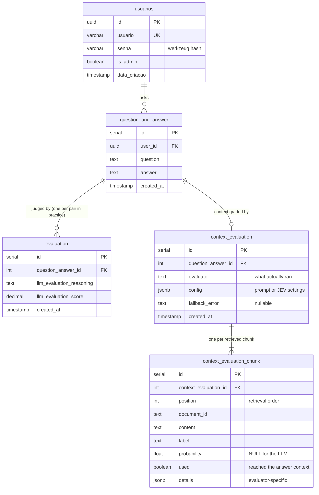

# Architecture

TutorIA answers computer-science questions using facts extracted from PDFs. Four independent processes share one Postgres database and one on-disk Chroma vector store; all LLM calls go to a local Ollama server.



| Process | Entry point | Runs as | Talks to |
|---|---|---|---|
| `rag` | `rag/main.py` | compose service, Flask on 5000 | Postgres, Chroma (read), Ollama |
| `judge` | `judge/main.py` | compose service, 15s loop | Postgres, Ollama |
| `process_files` | `process_files/process_files.py` | **manual**, 15s loop (not in compose) | Chroma (write) |
| `app` | `app/src/App.js` | compose service, CRA dev server on 3000 | `rag` via proxy `http://rag-tutoria:5000` |

The facts the tutor answers from only enter the system through `process_files`. The `POST /acd/enviar-arquivos` endpoint accepts a file but discards it, so it doesn't feed ingestion.

## 1. Ingestion: how facts reach the vector store

`process_files` turns PDFs into embedded chunks that the RAG step later retrieves. Run it from inside `process_files/`, because it resolves `documents/` and `processed_files.json` from `os.getcwd()`. It writes to `../db/tutor_ia_acd_db`, the same directory `rag` mounts at `/app/db`.



- The chunk id (`poo.pdf:3:1`) is the citation shown to the user: RAG returns these ids as `sources`.
- A file is tracked by **name only**. If you replace a PDF with a new version under the same name, it isn't reprocessed until you remove the name from `processed_files.json` (and delete its chunks if their content changed).
- `process_files/chroma.py` duplicates `db/chroma.py`. The embedding model and collection name must stay the same in both, or the query embeddings won't match the stored ones.

## 2. Chat request, end to end

The chat page sends the question to `POST /acd/resposta`. Everything from authentication to the stored Q&A happens within that one request.



### Conversation memory

- Each login issues a JWT with a fresh `user_session_id` (UUID). That value becomes the LangGraph `thread_id`, so **one login = one conversation thread**. Logging out and back in starts a new history.
- The `PostgresSaver` checkpointer stores the full `RagState` for the thread after every step. Earlier turns' messages are passed to the answer prompt, which is how follow-up questions work.
- The browser's `localStorage` copy of messages is for display only. The server never reads it.
- The checkpointer tables are created once by `rag/scripts/checkpoint_setup.py`, which `init.sh` runs via `init_checkpointer.sh`.

## 3. The RAG graph

The graph is built in `create_graph()` (`rag/rag_graph/rag_graph.py`) and rebuilt on every request. Its state is `RagState`, a `MessagesState` extended with `documents`, `sources`, `has_relevant_documents`, `hallucination_grade`, `answer_grade`, `context_evaluation` and `question_answer_id`.



### Step by step

1. **Routing** (`__router_choice__`): llama3.1 classifies the question and returns JSON `{"choice": "vectorstore" | "llm"}`. Computer science, programming and technology questions go to the vector store.
2. **Retrieval** (`__retrieve_context__`): `vector_store.as_retriever()` uses LangChain's default plain similarity search with `k=4`. Chroma embeds the question with the same `all-mpnet-base-v2` model and returns the 4 closest chunks. `sources` is set to their chunk ids.
3. **Context evaluation** (`__retrieved_context_evaluator_llm__`, default): `grade_documents_llm` makes **one LLM call per chunk**, asking whether the chunk is `relevant`, `partially_relevant` or `not_relevant` to the question. This is a lenient keyword-style check meant to drop wrong retrievals.
   (The alternative JEV evaluator is selected with `CONTEXT_EVALUATOR=jev` and applies `JEV_MIN_PROBABILITY` to these labels; see [jev-context-evaluator/JEV_CONTEXT_EVALUATOR.md](jev-context-evaluator/JEV_CONTEXT_EVALUATOR.md).)
4. **Filtering** (`filter_graded_documents`): keeps `relevant` chunks followed by `partially_relevant` ones and discards the rest. `sources` is narrowed to the kept ids. `has_relevant_documents` is true only if **at least one chunk is fully relevant**: partially relevant chunks are used as extra context but can't unlock an answer on their own. With JEV, a chunk is kept if P(relevant) + P(partially_relevant) reaches `JEV_MIN_PROBABILITY`, and it unlocks an answer only if P(relevant) reaches it too.
5. **Answer** (`__generate_answer__`):
   - If there's no relevant chunk, it returns the canned Portuguese refusal with no sources.
   - Otherwise it builds a system prompt that limits the model to computer science and to **only the retrieved context** (at most ten sentences). The kept chunks are joined in reverse order (partially relevant first, relevant last, closest to the question). The thread's human/system/AI messages are appended, and llama3.1 produces the answer.
6. **Persistence** (`__save_question_and_answer__`): inserts the last question and answer, with `user_id` taken from the run config metadata, into `question_and_answer`. Every answer is saved, including refusals, and becomes input for the judge.
7. **Evaluation record** (`record_context_evaluation`): stores what the evaluator decided for this turn, linked to the saved Q&A. See [Debugging context evaluations](#debugging-context-evaluations).

`__evaluate_answer_backed_by_context__`, a hallucination grader scoring 0–10 how well the chunks support the answer, is defined but **not wired into the graph**.

### Caveats in the current flow

These follow from reading the code. Check them before relying on them:

- The router calls the LLM **twice** and routes on the second result, which isn't lowercased. Any value other than exactly `vectorstore` / `llm` makes the graph fail.
- The `llm` route skips retrieval but still goes through `generate_answer`, which reads `has_relevant_documents` and uses the "only use the retrieved context" prompt. On a new thread that key hasn't been set yet, which should raise a `KeyError`. On an existing thread it reuses the **previous turn's** documents and flag. In practice the route only gives a sensible answer for off-topic questions when an earlier turn left relevant documents behind.
- `sources` contains chunk ids only (`file:page:chunk`, with `page` 0-based from `PyPDFLoader`), not page text.

## 4. The judge: LLM-as-a-judge, end to end

The judge scores every stored answer offline so admins can monitor answer quality. It runs separately from `rag`, so a slow judge never delays the chat.



- **What it grades:** usefulness of the answer to the question, using **only the question and answer**. The judge never sees the retrieved chunks, so it measures helpfulness, not whether the answer is grounded in the PDFs.
- **Model:** `deepseek-r1:8b` at temperature 0 (`judge/judgement/llm.py`), deliberately a different model family from the one that generated the answer.
- **Queue semantics:** "unjudged" means "has no row in `evaluation`". The oldest pairs go first, 10 per round. Canned refusals are judged too.
- **Failure behavior:** `main.py` has no error handling around the LLM call or the JSON parse. One bad response crashes the process, compose `restart: always` restarts it, and it picks up the same oldest pair again.

## Debugging context evaluations

The judge scores the final answer. This is a different record: what the context evaluator decided for **each retrieved chunk**, including discarded ones, so the LLM prompt or the JEV configuration can be refined from real questions. It is consulted on the admin-only **Contexto** screen (`/tutor-ia/context-evaluations`, `app/src/pages/ContextEvaluationsPage.js`), with SQL, or through the endpoint behind that screen, `GET /acd/avaliacoes-contexto?page=N&evaluator=jev`. The screen lists the questions with the evaluator that graded them, and clicking one shows the answer, each chunk with its grade, and the evaluator's configuration. `AdminRouter` hides the route, and the endpoint's `admin_validate` is what actually enforces access.

How the code is split:

| Concern | Where |
|---|---|
| Producing grades and describing the evaluator's configuration | `rag/rag_graph/context_evaluators.py` |
| Building the record (no I/O) and the `ContextEvaluationRecorder` interface | `rag/rag_graph/context_evaluation_record.py` |
| Deciding when to record | `record_context_evaluation` node in `rag/rag_graph/rag_graph.py` |
| SQL and `PostgresContextEvaluationRecorder` | `rag/api/context_evaluations/context_evaluations_repository.py` |

The graph only knows the interface: `create_graph(..., evaluation_recorder=...)` receives the recorder and defaults to Postgres. A new evaluator needs no schema change, because it only supplies its own `config` and grade extras.

What to know when reading the data:

- **`evaluator` is what actually ran.** When JEV fails, the LLM takes over and the row has `evaluator='llm'` with the reason in `fallback_error`.
- **`config` is a snapshot** of the prompt, or of the JEV instructions, criteria and threshold, so results can be compared before and after a change.
- **`used` means the chunk reached the answer context.** In a refusal every chunk has `used=false`, including `partially_relevant` ones kept by the filter.
- **`probability` is `NULL` for the LLM**, which only returns a label. Evaluator-specific fields, such as JEV's `probabilities` or the LLM's `raw_label`, are in `details`.
- **Recording is best effort.** A failure is logged as `Falha ao registrar a avaliação de contexto` and the student still gets the answer.
- **`content` can differ from the stored chunk by NUL bytes.** Some PDFs leave `\x00` in the extracted text, which Postgres rejects, so the repository removes them when saving.
- **Some turns have no record:** the `llm` route skips evaluation, and a turn that fails (invalid LLM JSON, Ollama down) has no Q&A row to attach to. The LLM record also has no reasoning, because the grader prompt asks for a label only.

Useful queries:

```sql
-- JEV chunks close to either decision of JEV_MIN_PROBABILITY: using the chunk (p_useful) or allowing an answer (p_relevant)
SELECT qa.question, c.document_id, c.label, (c.details->>'useful_probability')::float AS p_useful, (c.details->'probabilities'->>'relevant')::float AS p_relevant, c.used, e.config->>'min_probability' AS min_probability
FROM context_evaluation_chunk c
JOIN context_evaluation e ON e.id = c.context_evaluation_id
JOIN question_and_answer qa ON qa.id = e.question_answer_id
WHERE e.evaluator = 'jev' AND ((c.details->>'useful_probability')::float BETWEEN 0.6 AND 0.8 OR (c.details->'probabilities'->>'relevant')::float BETWEEN 0.6 AND 0.8)
ORDER BY p_useful;

-- Label distribution per evaluator and configuration, to compare before and after a change
SELECT e.evaluator, md5(e.config::text) AS config_version, min(e.created_at) AS first_seen, c.label, count(*) AS chunks
FROM context_evaluation_chunk c
JOIN context_evaluation e ON e.id = c.context_evaluation_id
GROUP BY e.evaluator, config_version, c.label
ORDER BY first_seen, e.evaluator, c.label;

-- How often the JEV fallback fires, per day
SELECT created_at::date AS day, count(*) FILTER (WHERE fallback_error IS NOT NULL) AS fallbacks, count(*) AS evaluations, max(fallback_error) AS example_error
FROM context_evaluation
GROUP BY day
ORDER BY day DESC;

-- Refusals: turns where no chunk reached the answer, with the grades that caused it
SELECT qa.question, e.evaluator, jsonb_agg(jsonb_build_object('document', c.document_id, 'label', c.label, 'probability', c.probability) ORDER BY c.position) AS grades
FROM context_evaluation e
JOIN context_evaluation_chunk c ON c.context_evaluation_id = e.id
JOIN question_and_answer qa ON qa.id = e.question_answer_id
GROUP BY e.id, qa.question, e.evaluator
HAVING NOT bool_or(c.used)
ORDER BY e.created_at DESC;

-- Labels outside the expected values, which the filter discards (usually the LLM not following the prompt)
SELECT e.evaluator, c.label, count(*) AS chunks
FROM context_evaluation_chunk c
JOIN context_evaluation e ON e.id = c.context_evaluation_id
WHERE c.label NOT IN ('relevant', 'partially_relevant', 'not_relevant')
GROUP BY e.evaluator, c.label;

-- Everything about one answer
SELECT qa.question, qa.answer, e.evaluator, e.fallback_error, c.position, c.document_id, c.label, c.probability, c.used, c.details
FROM question_and_answer qa
JOIN context_evaluation e ON e.question_answer_id = qa.id
JOIN context_evaluation_chunk c ON c.context_evaluation_id = e.id
WHERE qa.id = 1
ORDER BY c.position;
```

## Shared code and imports

- The repo-root `db/` package (`postgres.py`, `chroma.py`) is shared by `rag` and `judge` via the compose volume mount `./db:/app/db`. Both services import it as `db.postgres` / `db.chroma` with `/app` as the working dir. The Chroma store itself is persisted under `db/tutor_ia_acd_db/` (gitignored).
- `rag/rag_graph/rag_graph.py` calls `get_chroma_db()` at import time, which loads the embedding model. Tests stub `db.chroma` for that reason (see `rag/tests/conftest.py`).
- Python modules inside each service use imports relative to the service root (e.g. `from api.token import ...`), so run them from that directory (or inside the container), not from repo root. The root-level `main.py` is a CLI REPL for the RAG graph and imports `rag.rag_graph...`, which conflicts with that convention.
- `rag` and `judge` read env vars (`DB_*`, `OLLAMA_URL`, `JWT_*`, `CONTEXT_EVALUATOR`) from `.env` via compose `env_file`.

## API conventions (rag)

- Auth: `@token_required_as_param` validates `Authorization: Bearer <jwt>`, checks the user still exists, and passes the decoded payload as the first positional arg to the view. Stack `@admin_validate` beneath it for admin-only endpoints.
- Responses are built manually with `Response(json.dumps(...), mimetype="application/json")` and carry a `status: "success"|"error"` field, with error text under `erro`.
- Controllers return `(success: bool, data, message)` tuples; repositories take a psycopg connection (rows as dicts via `dict_row`).
- LLM availability is not a startup requirement: `rag`/`judge` only wait for `ollama` to *start*, so login and pages work while Ollama is down. Routes that call the LLM catch `LLM_UNAVAILABLE_ERRORS` (`rag/rag_graph/models.py`) and return `503` with a Portuguese `erro`, which the frontend shows as-is. The `ollama` service has a Docker healthcheck (local API + `eth0` present, catching the case where the container starts detached from the compose network); it is informational only — check `docker compose ps` — and `init.sh` waits on it before pulling models.
- Ollama ports: `rag` and `judge` use `OLLAMA_URL=http://ollama-tutoria:11434`, the container port on the compose network. The service is published on the host as `11435` so it doesn't collide with an Ollama installed on the machine, which listens on `11434`. That collision made the container start fail with `failed to bind host port 0.0.0.0:11434/tcp: address already in use`, and retrying after stopping the host service left it running with no network (`unhealthy`, with `rag` failing DNS on `ollama-tutoria` and answering `503`). If a container is in that state, or another service holds `11435`, free the port and run `docker compose up -d --force-recreate ollama`.

## Database

Schema lives in `db-scripts/create_tables.sql`, executed by the Postgres image only when the data volume is first created (no migration tool). The LangGraph checkpoint/store tables are created separately by `rag/scripts/checkpoint_setup.py`.

The context evaluation tables live in `db-scripts/upgrade_context_evaluation.sql`, which is idempotent. On a new volume it runs automatically after `create_tables.sql`, since the scripts run in alphabetical order. On an existing volume, apply it once:

```bash
docker compose exec db sh -c 'psql -U "$POSTGRES_USER" -d "$POSTGRES_DB" -f /docker-entrypoint-initdb.d/upgrade_context_evaluation.sql'
```

Until then chat keeps working, and each turn logs `Falha ao registrar a avaliação de contexto`.



## Models

LLM names are hard-coded constants: `MODEL = "llama3.1:8b"` in `rag/rag_graph/models.py`, `MODEL="deepseek-r1:8b"` in `judge/judgement/llm.py`. If you change one, update `init.sh` so the model gets pulled. All LLM steps expect JSON output parsed with `JsonOutputParser`. The embedding model `sentence-transformers/all-mpnet-base-v2` is set in both `db/chroma.py` and `process_files/chroma.py`. The optional JEV evaluator is an external API (`TYPESAFE_API_KEY`), pinned via `JEV_MODEL` (default `jev-1.13.0`) rather than the moving `jev-latest` alias.
