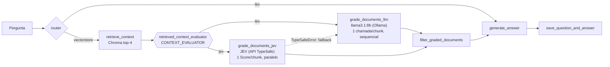

# Avaliação de contexto com JEV x LLM local

> **Resultados:** cada rodada do benchmark tem um documento próprio nesta pasta, com data no nome.
>
> - [BENCHMARK_2026-10-31.md](BENCHMARK_2026-10-31.md): primeira rodada válida. O JEV foi cerca de 40× mais rápido e teve macro-F1 de 0,81 contra 0,54 do LLM.

## 1. Resumo

O TutorIA é um RAG corretivo. Depois da busca semântica, o nó `retrieved_context_evaluator` classifica cada chunk recuperado como `relevant`, `partially_relevant` ou `not_relevant`. A resposta só é gerada se pelo menos um chunk for `relevant`. Até agora essa classificação era feita pelo `llama3.1:8b` via Ollama, com uma chamada por chunk em sequência e saída em JSON gerado.

Este documento descreve uma segunda implementação desse passo usando o **JEV**, da TypeSafe, um modelo voltado para decisões estruturadas (classificação) em vez de geração de texto. Os dois avaliadores convivem no código, e um benchmark offline compara os dois em **tempo** e **assertividade**.

## 2. O que é o JEV e se ele serve para esta tarefa

O JEV é o modelo principal da TypeSafe e o primeiro do tipo que a empresa chama de *System One*. Ele recebe um `state` (texto ou JSON) e um conjunto de perguntas tipadas, e devolve respostas estruturadas sem gerar texto ([introdução](https://docs.typesafe.ai/introduction)). Os tipos de pergunta são:

| Tipo | Resposta | Uso |
|---|---|---|
| [Score](https://docs.typesafe.ai/primitives/score) | `score`, `probabilities` por nível, `confidence` | Classificar em níveis ordenados. **É o tipo usado aqui.** |
| [Choice](https://docs.typesafe.ai/primitives/choice) | `choice`, `probabilities`, `confidence` | Escolher uma opção de um conjunto. |
| [Noul](https://docs.typesafe.ai/primitives/noul) | `noul` (probabilidade de "sim", de 0 a 1) | Perguntas de sim ou não. |

**Veredito: sim, o JEV substitui o LLM nessa etapa.** A documentação tem um cookbook para exatamente esse problema, [*Classifying RAG passages*](https://docs.typesafe.ai/cookbooks/classifying_rag_passages): uma requisição por par (pergunta, passagem), com a decisão de incluir ou descartar tomada em código.

Vantagens esperadas:
- **Sem saída gerada**, então não existe JSON inválido. No LLM, uma resposta fora do formato faz o `JsonOutputParser` lançar exceção e derruba a requisição.
- **Probabilidades calibradas e confiança** por decisão, o que permite ajustar limiares em código sem reescrever prompt.
- **Latência e paralelismo:** cada chunk é uma requisição independente, então as requisições podem rodar em paralelo. No Ollama local, com uma GPU, as chamadas acabam serializadas.
- **Custo baixo:** US$ 0,042 por milhão de tokens de entrada; tokens de saída são gratuitos ([models](https://docs.typesafe.ai/models)).

Limitações e riscos levantados na documentação:

| Ponto | Impacto no TutorIA |
|---|---|
| Só existe como **API na nuvem**; não há self-hosting documentado | Quebra a premissa de "tudo local via Ollama". Os chunks saem da máquina, a disponibilidade passa a depender de rede e rate limit, e o serviço exige `TYPESAFE_API_KEY`. |
| **Inglês** é a língua principal; outras línguas "não funcionam igualmente bem" ([models](https://docs.typesafe.ai/models#language-support)) | O corpus mistura PT e EN. Instruções e níveis foram escritos em inglês e os resultados são separados por idioma. |
| Leitura **literal** das instruções e sensibilidade a **conteúdo adversarial** ([jaggedness](https://docs.typesafe.ai/model-jaggedness/jev-1.13)) | Os níveis descrevem situações concretas. Nada aqui funciona como barreira de segurança. |
| O alias `jev-latest` muda de versão sem aviso | O modelo fica fixado em `jev-1.13.0` (`JEV_MODEL`). |

## 3. Arquitetura



- **Código:** `rag/rag_graph/context_evaluators.py` concentra os dois graders e o filtro comum. `rag/rag_graph/rag_graph.py` registra um nó por avaliador e `create_graph(..., context_evaluator=None)` escolhe qual usar. O nome do nó e as arestas do grafo não mudaram.
- **Seleção:** argumento `context_evaluator` ou variável `CONTEXT_EVALUATOR` (`llm` por padrão, ou `jev`).
- **Requisição JEV**, uma por chunk:

  ```python
  state = {"query": pergunta, "passage": {"id": doc.id, "text": doc.page_content}}
  questions = {"relevance": Score(
      instructions="How well does `passage.text` answer `query`? ...",
      criteria=[  # nível 0, 1, 2
          "The passage is about a different subject than the query.",                 # not_relevant
          "...same subject, but does not contain enough information to answer it.",   # partially_relevant
          "The passage contains information that directly answers the query.",       # relevant
      ])}
  ```

  O rótulo é o nível de maior probabilidade. Em caso de empate, prevalece o menos relevante. `probabilities`, `confidence` e os tokens são guardados para análise.
- **Regra de filtragem**, igual para os dois avaliadores: `relevant` e `partially_relevant` seguem para a geração, e a resposta só é gerada se houver pelo menos um `relevant`.
- **Resiliência:** qualquer `TypeSafeError` (chave inválida, 429/529 depois dos retries do SDK, timeout) faz o nó registrar o erro no log e reavaliar com o LLM.
- **Configuração** (`.env`):

  | Variável | Padrão | Descrição |
  |---|---|---|
  | `CONTEXT_EVALUATOR` | `llm` | `llm` ou `jev` |
  | `TYPESAFE_API_KEY` | (vazio) | Chave do [console da TypeSafe](https://console.typesafe.ai/); só é necessária com `jev` |
  | `JEV_MODEL` | `jev-1.13.0` | Versão fixa do modelo |
  | `JEV_MAX_WORKERS` | `4` | Requisições simultâneas ao JEV |

## 4. Metodologia do comparativo

- **Perguntas** (`rag/benchmark/data/questions.json`): 42 perguntas em PT. São 34 cobertas pelo corpus (POO, programação funcional, bancos de dados, microsserviços, ágil, TDD/BDD, SOLID, estruturas de dados, complexidade, grafos, RAG/LLMs), 5 fora do corpus e 3 com premissa falsa.
- **Dataset** (`python -m benchmark.build_dataset`): para cada pergunta, o mesmo retriever do grafo recupera os top-4 chunks, o que dá cerca de 168 pares pergunta–chunk. O tempo de retrieval de cada pergunta também é medido, e o idioma de cada chunk é detectado (PT/EN).
- **Gabarito:** coluna `gold_label`. Na rodada de 31/10/2026, 8 rótulos foram feitos pelo autor e os outros 160 pelo Claude, seguindo o mesmo critério (veja as ameaças à validade no documento da rodada). Os critérios são:
  - `relevant`: o chunk sozinho permite responder, mesmo que parcialmente, à pergunta;
  - `partially_relevant`: trata do assunto, mas não traz a informação pedida;
  - `not_relevant`: assunto diferente.
- **Modos medidos** (`python -m benchmark.run_benchmark`), sempre sobre os mesmos chunks e com N=3 repetições, depois de um warm-up que fica fora da medição:
  - `llm`: llama3.1:8b, um chunk por vez (como em produção);
  - `jev_sequential`: JEV, uma requisição por vez (comparação nas mesmas condições do LLM);
  - `jev_parallel`: JEV com `JEV_MAX_WORKERS` requisições simultâneas (como em produção).
- **Métricas:**
  - **Tempo:** média, p50 e p95 por chunk e por pergunta, e o total de retrieval + avaliação.
  - **Assertividade contra o gabarito:**
    - acurácia, precisão/recall/F1 por classe, macro-F1, kappa e matriz de confusão (3 classes);
    - acurácia binária (relevant vs. resto, a decisão que o grafo efetivamente usa);
    - **acurácia do gate** por pergunta: responder ou recusar.
  - **Recortes e extras:**
    - resultados por idioma do chunk e por tipo de pergunta;
    - estabilidade dos rótulos entre repetições;
    - taxa de erro (JSON inválido no LLM, falha de API no JEV);
    - kappa LLM x JEV;
    - custo em tokens do JEV;
    - análise de limiares sobre P(relevant) do JEV.
- **Ambiente:** registrar a GPU usada pelo Ollama, a conexão de rede e a data, já que a latência do JEV inclui a ida e volta pela internet.

## 5. Resultados e conclusões

Os resultados, a discussão e as conclusões ficam num documento separado para cada rodada do benchmark:

| Rodada | Documento | Destaques |
|---|---|---|
| 31/10/2026 | [BENCHMARK_2026-10-31.md](BENCHMARK_2026-10-31.md) | O JEV levou 0,24 s por pergunta, contra 9,62 s do LLM. A acurácia por chunk foi de 0,815 contra 0,613 (p < 0,001). No gate, 0,929 contra 0,857 (sem significância). O JEV não respondeu nenhuma pergunta sem contexto relevante. A principal ressalva é o gabarito, majoritariamente rotulado por modelo |

A rodada de 20/10/2026 foi descartada: o Ollama estava sem rede e todas as chamadas do LLM falharam.

Ao registrar uma nova rodada, crie `BENCHMARK_<AAAA-MM-DD>.md` nesta pasta e acrescente uma linha na tabela acima.

## Como reproduzir

```bash
# 1. configurar .env (TYPESAFE_API_KEY) e subir os serviços
docker compose up -d --build

# 2. gerar o dataset para anotação
docker compose exec rag python -m benchmark.build_dataset

# 3. anotar rag/benchmark/data/dataset.csv (coluna gold_label)

# 4. rodar o comparativo
docker compose exec rag python -m benchmark.run_benchmark --repetitions 3

# testes da feature
docker compose exec rag python -m pytest
```
